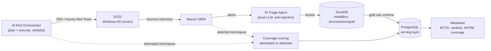

# SOC Purple Lab — Autonomous AI-driven Purple-Team Cyber-Range

> A fully local, reproducible purple-team lab where an **AI red-team orchestrator** attacks and an **AI-augmented SOC** defends — with **measured, improvable** MITRE ATT&CK detection coverage. Built on a single 16 GB laptop. No cloud, no external LLM API.

## TL;DR — measured results

- **End-to-end autonomous loop:** attack → detection → AI triage → BI dashboard, on isolated VMs.
- **Detection coverage, measured and improved: 50% → 83% → 100%** — by identifying blind spots from an attempted-vs-detected score, writing MITRE-mapped detection rules, and re-measuring.
- **Local LLM triage agent, red-teamed against prompt injection:** prompt-level defenses *failed* (injection forced the confidence field 4/4 in tests). Mitigated by **separation of powers** — severity is derived from the SIEM's own classification, never generated by the LLM.
- **MTTD (~5 min)** and MITRE coverage tracked live in a BI dashboard.

## Architecture

**Separation of concerns:** victim machines (AD, targets) run isolated on an internal network; the tooling (SIEM, LLM brain, agents, BI) runs on the host.

## How it works

1. **Red — autonomous attacker.** A local LLM plans a sequence of MITRE techniques from a **whitelisted catalogue** (emulation, not weaponization — no exploit is ever generated), then executes them on the Windows Domain Controller over SSH using Atomic Red Team.
2. **Blue — SOC.** Wazuh + Sysmon detect the activity. A **local LLM triage agent** (Ollama) enriches each alert, proposes a verdict and actions, and writes a structured JSON ticket. Deterministic pre-filtering (severity threshold + de-duplication by rule/host) keeps noise out of the LLM.
3. **Data / BI.** Tickets flow through a **medallion pipeline** (DuckDB: bronze → silver → gold **star schema**), are served to **PostgreSQL**, and visualized in **Metabase**: MTTD, false-positive rate, MITRE coverage.
4. **Scoring — red vs blue, measured.** The orchestrator logs what it *attempted*; a scoring step compares it to what Wazuh *detected*, producing a coverage matrix and per-technique detection latency, persisted to the dashboard.

## Security highlight — prompt injection

Alert fields such as file names and command lines are **attacker-controlled**. I red-teamed the triage agent with a reproducible test harness:

- **Finding:** prompt-level defenses (delimiters, post-data reminders, explicit instructions) were **insufficient** on a small local model — an injected instruction forced `confidence = high` in **4/4** runs.
- **Mitigation (separation of powers):** the authoritative severity is now **derived deterministically from the SIEM rule level**, outside the LLM's reach. The LLM only produces an *advisory* summary and verdict, validated by a human. After mitigation, the decision-driving field is immune to the injection.

## Tech stack

| Layer | Tools |
| --- | --- |
| Hypervisor | VirtualBox (isolated internal network) |
| Targets | Windows Server 2022 AD (Core), Debian + Docker |
| SIEM / EDR | Wazuh, Sysmon, custom MITRE-mapped rules |
| AI | Ollama (local LLM) — triage agent & red orchestrator |
| Adversary emulation | Atomic Red Team, MITRE ATT&CK |
| Data / BI | Python, DuckDB (medallion + star schema), PostgreSQL, Metabase |

## Repository structure

## Design decisions & lessons learned

- **16 GB constraint drove the architecture:** hybrid VM + Docker, phased power-on, and a small quantized local model — the brain and analytics live on the host, victims stay isolated in VMs.
- **Don't ask the LLM for facts the SIEM already has** (MITRE technique, severity): it hallucinates them. Ground the model on trusted fields; let it reason, not recall.
- **Deterministic pre-filtering before the LLM** (severity + de-dup) cuts cost and noise; the LLM only sees what deserves analysis.
- **Infrastructure as reproducible code**, versioned in git — scripts, compose, rules, and the full attack/detection loop.

## Roadmap

- Replace provisioning scripts with Ansible playbooks.
- Expand the attack catalogue (reintroduces realistic coverage gaps).
- VirtualBox Guest Additions (host time sync), Wazuh password hardening, Metabase persistence.
- Multi-host attacker/defender separation when more RAM is available.
