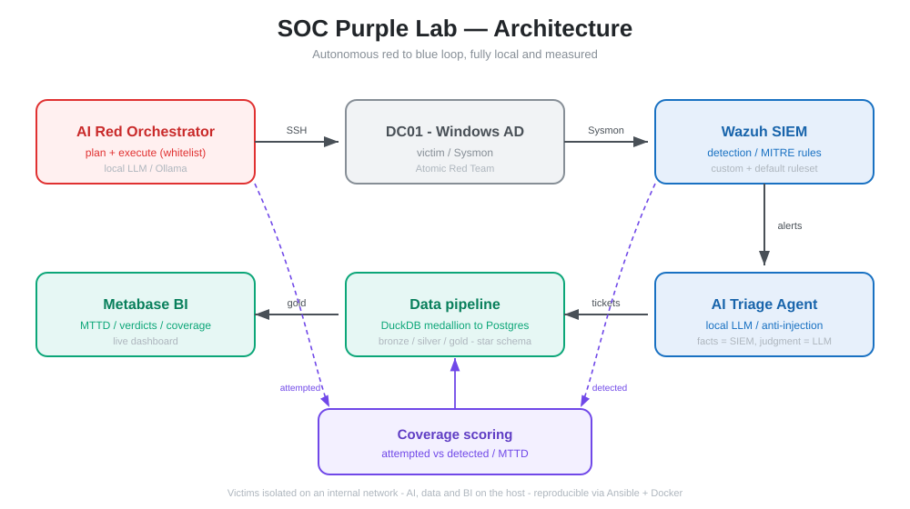

# SOC Purple Lab — Autonomous AI-driven Purple-Team Cyber-Range

> A fully local, reproducible purple-team lab where an **AI red-team orchestrator** attacks and an **AI-augmented SOC** defends — with **measured, improvable** MITRE ATT&CK detection coverage. Runs on a single 16 GB laptop. No cloud, no external LLM API.

## TL;DR — measured results

- **End-to-end autonomous loop:** AI plans & executes attacks → SIEM detects → local-LLM triage → BI dashboard, on isolated VMs.
- **Detection coverage, measured and improved:** an attempted-vs-detected score revealed blind spots; writing MITRE-mapped rules and re-measuring moved coverage **50% → 100%**, then back to a realistic **87%** as the attack catalogue grew.
- **Red-teamed the triage LLM against prompt injection:** prompt-level defenses *failed* (forced the confidence field 4/4). Mitigated by **separation of powers** — severity is derived from the SIEM, never generated by the LLM.
- **Fully reproducible:** Infrastructure-as-Code with **Ansible (Linux + Windows, idempotent)**, Docker, scripted VMs, and a one-command lab resume.

## Architecture

Victim machines (AD, targets) run isolated on an internal network; the tooling (SIEM, LLM brain, agents, BI) runs on the host.

## How it works

1. **Red — autonomous attacker.** A local LLM plans a sequence of MITRE techniques from a **whitelisted catalogue** (emulation, not weaponization — no exploit is generated), executes them on the Windows DC over SSH via Atomic Red Team, and logs what it attempted.
2. **Blue — SOC.** Wazuh + Sysmon detect the activity. A **local LLM triage agent** (Ollama) enriches each alert, proposes a verdict, and writes a structured ticket. Deterministic pre-filtering (severity threshold + de-duplication by rule/host) keeps noise out of the LLM.
3. **Data / BI.** Tickets flow through a **medallion pipeline** (DuckDB: bronze → silver → gold **star schema**), served to **PostgreSQL** and visualized in **Metabase**: MTTD, false-positive rate, MITRE coverage.
4. **Scoring — red vs blue, measured.** Attempted techniques are compared to Wazuh detections, producing a **coverage matrix** and per-technique detection latency, persisted to the dashboard (coverage over time).

## Security highlight — prompt injection

Alert fields (file names, command lines) are **attacker-controlled**. I built a reproducible red-team harness:

- **Finding:** prompt-level defenses (delimiters, post-data reminders, explicit instructions) were **insufficient** on a small local model — an injected instruction forced `confidence = high` in **4/4** runs.
- **Mitigation (separation of powers):** the authoritative severity is **derived deterministically from the SIEM rule level**, outside the LLM's reach. The LLM only produces an *advisory* summary and verdict, validated by a human. After mitigation, the decision-driving field is immune to the injection.

## Reproducibility (Infrastructure as Code)

- **Ansible, idempotent, multi-OS:** `deploy-rules.yml` deploys MITRE-mapped detection rules to the Wazuh manager (handler-driven restart); `deploy-dc01.yml` provisions the Windows endpoint from scratch (Sysmon + agent + config + services) over SSH, and is safe to re-run (does nothing when already in the desired state).
- **One-command lab resume:** `infra/resume-lab.sh` boots the VMs, restores port forwards, and aligns clocks.
- **Everything versioned:** VM scripts, Docker Compose, detection rules, and the full attack/detection loop live in git.

## Tech stack

| Layer | Tools |
| --- | --- |
| Hypervisor | VirtualBox (isolated internal network) |
| Targets | Windows Server 2022 AD (Core), Debian + Docker |
| SIEM / EDR | Wazuh, Sysmon, custom MITRE-mapped rules |
| AI | Ollama (local LLM) — triage agent & red orchestrator |
| Adversary emulation | Atomic Red Team, MITRE ATT&CK |
| Data / BI | Python, DuckDB (medallion + star schema), PostgreSQL, Metabase |
| IaC | Ansible (Linux + Windows), Docker, shell/PowerShell |

## Repository structure

## Design decisions & lessons learned

- **16 GB constraint drove the architecture:** hybrid VM + Docker, phased power-on, a small quantized local model — brain and analytics on the host, victims isolated in VMs.
- **Don't ask the LLM for facts the SIEM already has** (MITRE technique, severity): it hallucinates them. Ground the model on trusted fields; let it reason, not recall.
- **Deterministic pre-filtering before the LLM** (severity + de-dup) cuts cost and noise.
- **Honest coverage over cosmetic coverage:** some techniques (e.g. T1012 registry query) are intentionally left undetected and documented — detecting them naively would flood false positives. Real SOC trade-offs, not a fake 100%.

## Roadmap

- Correlation-based detection for noisy techniques (e.g. T1012 in context).
- Packer to fully automate the Windows OS install (beyond config management).
- Grow the attack catalogue; multi-host attacker/defender separation when more RAM is available.
