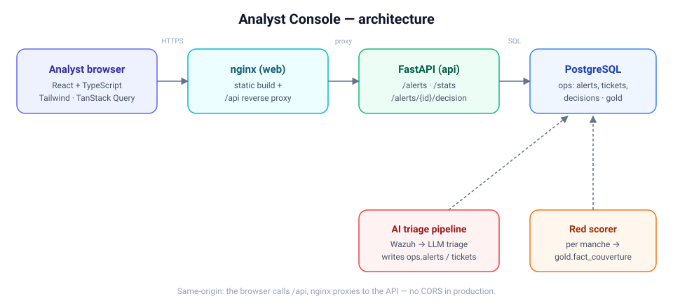

# Analyst Console

A React/TypeScript web console on top of the SOC Purple Lab: an analyst triages
alerts, reads the AI agent's advisory ticket, and records a decision (validate /
false positive / escalate). Every decision is audited, and the agreement between
the analyst and the agent is tracked over time.



## Screenshots
<!-- Save your screenshots into console/docs/ with these names. -->
| Alerts queue | Alert detail + decision | Stats |
|---|---|---|
|  |  |  |


## What it does
- **Alerts queue** — server-paginated table with severity/status badges and combinable filters (severity, status, text) kept in the URL via `useSearchParams`, so views are shareable and refresh-proof.
- **Detail & decision** — the SIEM facts and the agent's ticket side by side; Validate / False positive / Escalate with an **optimistic** TanStack Query mutation and an optional comment; full decision history.
- **Stats** — alerts by severity over time, detection coverage per round, and the analyst↔agent agreement rate, all aggregated **in SQL** server-side (Recharts only draws).

## Architecture
- **web** — Vite + React + TypeScript + Tailwind, built to static files and served by **nginx**, which reverse-proxies `/api` to the API (same origin → no CORS in production).
- **api** — FastAPI + psycopg3 over an **operational `ops` schema** (`alerts`, `tickets`, `decisions`) kept separate from the analytical gold star schema. OpenAPI spec drives the front-end TypeScript types (`npm run gen:api`).
- **data** — the AI triage pipeline writes alerts/tickets into `ops`; the red-team scorer feeds detection coverage into `gold`.

## Run — development
```bash
# API (terminal 1)
cd api && python -m venv .venv && source .venv/bin/activate
pip install -r requirements.txt
psql "$DATABASE_URL" -f db/ops_schema.sql     # once; or via the postgres container
uvicorn app.main:app --reload                 # :8000

# Web (terminal 2)
cd web && npm install && cp .env.example .env
npm run gen:api                               # types from the running API
npm run dev                                   # :5173
```

## Run — Docker (alongside the lab's PostgreSQL)
Add the `api` and `web` services from `../docs/console-compose-snippet.yml` to
`bi/docker-compose.yml`, then:
```bash
docker compose -f bi/docker-compose.yml up -d --build api web
# web  -> http://localhost:8080   (nginx, proxies /api)
# api  -> http://localhost:8000   (OpenAPI docs at /docs)
```

## Stack
FastAPI · psycopg3 · PostgreSQL · React 19 · TypeScript · Tailwind v4 ·
TanStack Query · React Router · Recharts · Vite · nginx · GitHub Actions CI.

## CI
`.github/workflows/ci.yml` runs on every push: **API** job (`pytest`, offline) and
**Web** job (`tsc --noEmit` + `vite build`).
